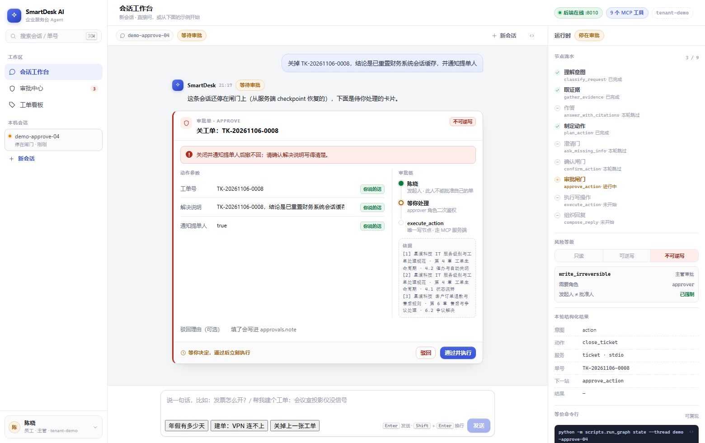
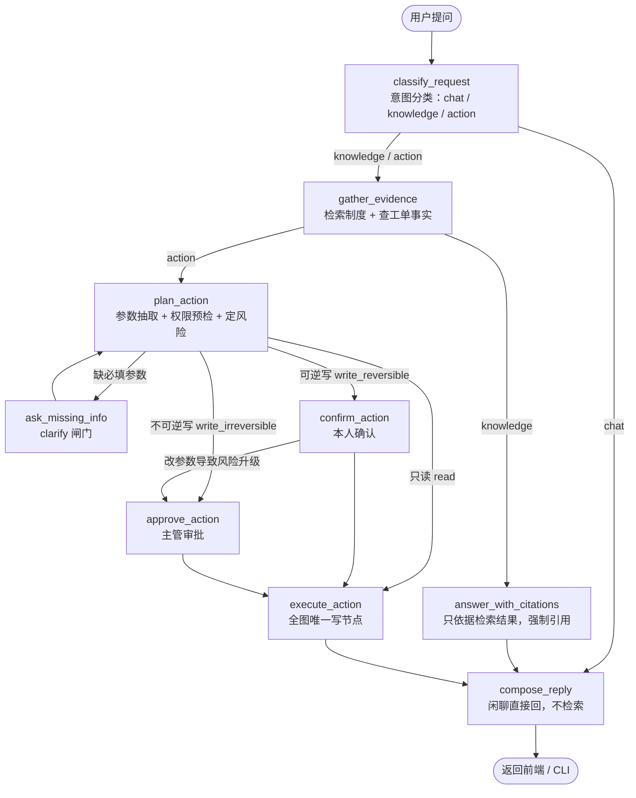
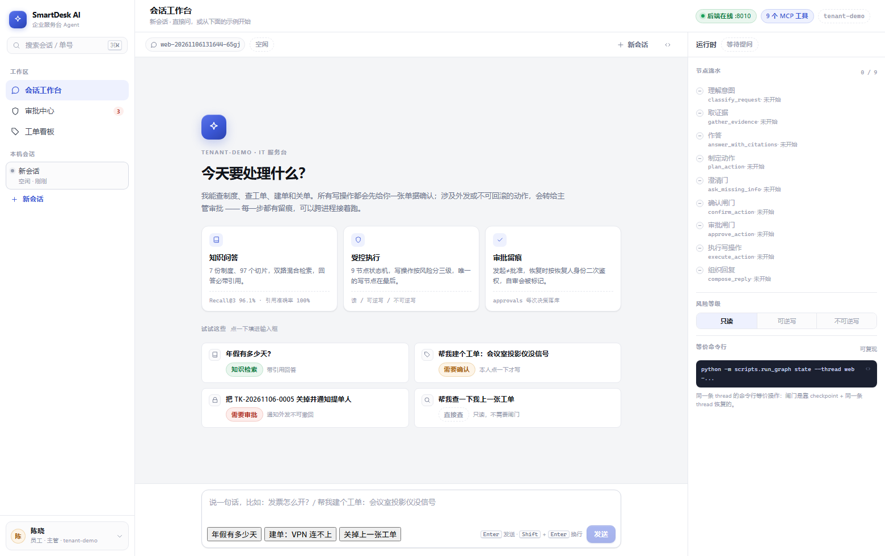
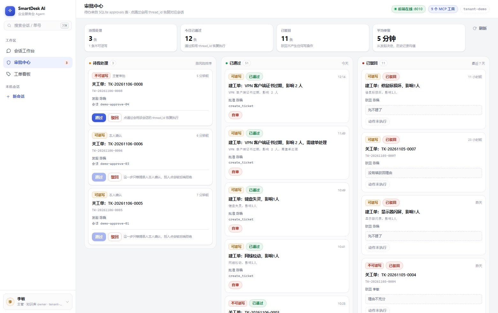
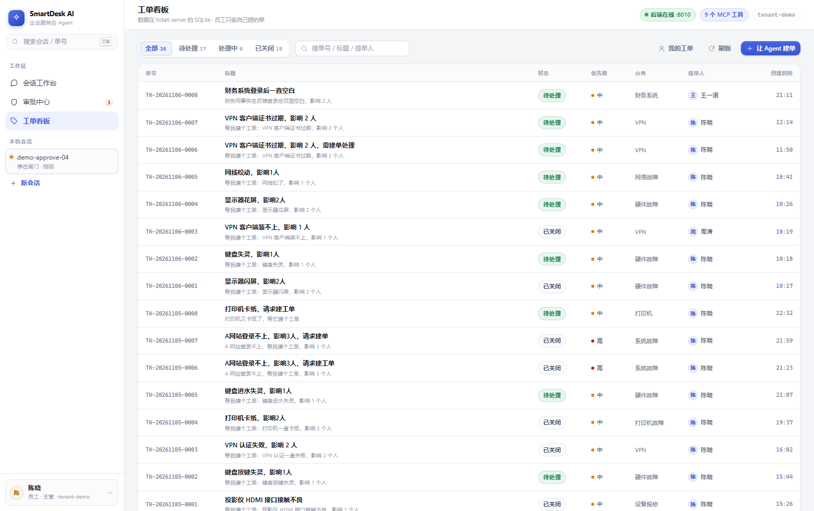

# SmartDesk-Agent · 企业内部服务台 Agent

**用自然语言问制度、查工单、建单、关单。Agent 要么给出带引用的答案，要么把写操作做成分级闸门——只读直通，可逆写要本人确认，不可逆/对外要主管审批，停下时状态写进 checkpoint，换个进程也能接着批。**



核心不是"把知识库接进模型"，而是把 **回答** 和 **动作** 分开：

- **回答**只依据检索到的制度，强制带 `[1][2]` 引用，找不到就说"知识库没有这条"并给下一步；
- **动作**按危险程度分级，风险不是静态配置：关单时勾了"通知提单人"，风险就从「可逆写」自动升到「不可逆写」；
- **谁批准**由权限算出来，不由对话里说了什么算：恢复时按恢复人的角色二次鉴权，发起人批自己的单会被标 `self_approved`。

## 30 秒看懂

| | |
|---|---|
| **9 节点 / 5 条路由** | 分支全部集中在 `backend/app/agents/graph.py`，节点只返回字段，路由才知道下一站 |
| **3 级风险闸门** | `action_spec.py` 的 `RISK_BY_OP` + `compute_risk()`：同一动作带不同参数，风险可以不同 |
| **跨进程审批** | `interrupt` 挂起 → 记录进 `approvals`（带 `thread_id`）→ 审批中心点一下，用同一个 `thread_id` resume |
| **2 个 MCP server / 9 个工具** | 工单库和知识库各一个 FastMCP server，**鉴权在 server 侧**（同租户 + 本人/特权），不靠前端藏按钮 |
| **二级混合检索** | Milvus 稠密 1024 维 + 内置中文 BM25 经 `RRFRanker(k=60)` 粗排 Top-10 → `gte-rerank-v2` Cross-Encoder 精排融合取 Top-3（带 `tenant_id` 过滤与异常自动降级） |
| **有评测与消融** | 51 条标注问句：Recall@1 **86.27%**（+3.92pp）、Recall@3 **98.04%**（+1.96pp）、MRR@3 **0.9150**；20 条端到端用例引用准确率 **100%** |

## 架构



两条关键约束写死在代码里，不靠提示词：

1. **只有 `execute_action` 会写**，且执行前再兜底一次 `state["risk"] == "write_irreversible" and not approved`；
2. **闸门是 `interrupt` 不是弹窗**：状态存 checkpoint，进程重启后同一 `thread_id` 仍可 resume —— 这是"跨进程人工审批"的实现方式。

## 界面

| 会话工作台 | 审批中心 |
|---|---|
|  |  |

右侧「运行时」面板把 Agent 的 9 个节点、风险阶梯、结构化结果和等价命令行都摊开——演示时可以直接指着说"它停在这一格，是因为通知发出去撤不回"。

| 审批单据（可审阅） | 工单看板 |
|---|---|
|  |  |

闸门卡片被做成一张**可审阅的单据**：为什么要审批、每个参数从哪来（你说的话 / 证据回填 / 上下文）、审批链上谁是发起人谁是待批人，都在卡片里。

列表页的内容区有五种状态：读取中（骨架） / 真的没有数据 / 筛选后为空 / 读失败 / **后端没连上**（直接把启动命令写在页面中间，避免"看起来像空的"）。最后一种的样子见 [06-backend-down.png](docs/screenshots/06-backend-down.png)。

## 技术栈

| 层 | 技术 |
|---|---|
| 编排 | LangGraph 1.x（`StateGraph` / `interrupt` / `Command` / checkpointer） |
| 模型 | LangChain 1.x（`init_chat_model`；分类走结构化输出，参数抽取走确定性规则） |
| 检索 | Milvus（稠密 1024 维 + 内置 BM25，服务端 `RRFRanker(k=60)` 粗排）+ DashScope `gte-rerank-v2` Cross-Encoder 精排 |
| 工具 | FastMCP 2 个 server（9 个工具），`MultiServerMCPClient` 装配，权限在 server 侧 |
| 持久化 | PostgreSQL（`PostgresSaver`）+ 本地 SQLite 兜底；`approvals` 表存审批 |
| 后端 | FastAPI + SSE（`/chat/stream`、`/runs/{id}/resume` 等） |
| 前端 | Vue3 + Vite + TypeScript + Element Plus（深度定制，会话 / 审批 / 工单三页） |

## 目录

```
backend/app/
  agents/           主图与节点：graph.py state.py checkpoint.py knowledge.py
    nodes/          9 个节点 + 动作规则表（action_spec.py）
    rag/            Milvus 读写、Cross-Encoder 精排（reranker.py）、embedding、MinerU 解析、结构感知切分
    tools/          MCP 客户端与工具封装
    prompts/        分类 / 作答 / 闲聊提示词
  mcp/servers/      ticket_server.py / kb_server.py / guard.py（鉴权）
  api/              main.py routes.py streaming.py deps.py
frontend/src/        styles/（设计 token）components/ views/ stores/ utils/
scripts/             run_graph（CLI）/ ingest_docs（入库）/ eval_rag（评测）/ trace_run / reset_demo（重置演示数据）
deploy/              docker-compose.yml（Milvus / etcd / PostgreSQL / attu）
docs/kb/             知识库源文档（7 份虚构制度）、PDF、解析产物、chunks
docs/eval/           51 条评测集与报告
docs/screenshots/    界面截图
```

## 快速开始

```bash
# 0) 环境：Python 3.12 + Node 20+ + Docker Desktop
uv sync                                        # 或：python -m venv .venv && .venv/Scripts/pip install -e .

# 1) 依赖服务（Milvus / PostgreSQL，deploy/.env 已配好默认端口与镜像）
docker compose -f deploy/docker-compose.yml up -d
docker compose -f deploy/docker-compose.yml ps      # 等 milvus healthy

# 2) 配置环境变量（自己填 key，不要提交）
cp .env.example .env    # 填 DEEPSEEK_API_KEY、DASHSCOPE_API_KEY

# 3) CLI：知识问答 / 建单 / 审批
.venv/Scripts/python.exe -m scripts.run_graph run --thread t1 -m "年假有多少天？"
.venv/Scripts/python.exe -m scripts.run_graph run --thread t2 -m "帮我建个工单：VPN 连不上"
.venv/Scripts/python.exe -m scripts.run_graph resume --thread t2 --approve

# 4) HTTP + SSE
.venv/Scripts/python.exe -m uvicorn backend.app.api.main:app --port 8010

# 5) 前端（另开终端）
cd frontend && npm install && npm run dev     # 浏览器开 http://localhost:5173
```

首次使用需要入库（仓库未提交向量数据）：

```bash
.venv/Scripts/python.exe -m scripts.ingest_docs --md docs/kb/md --to-milvus
```

## 一分钟演示脚本

1. **知识问答**：`年假有多少天？` → 答复带 `[1][2]` 引用，右侧能看到 `gather_evidence` 的耗时；
2. **可逆写**：`帮我建个工单：会议室投影仪没信号` → 停在**确认**闸门，改一下标题再点通过，工单落库；
3. **不可逆写**：`把 TK-20261106-0005 关掉并通知提单人` → 风险从「可逆写」升级为「不可逆写」，停在**审批**闸门；
4. **换人审批**：左下角身份卡切成主管（`u-9001`）→ 审批中心点「通过」→ 会话用原 `thread_id` 恢复执行，工单状态变 `closed`；
5. **越权演示**：切成员工 `u-7777` 查别人的单 → `outcome=denied`，提示"只有提单人本人或主管能处理"。

## 评测

51 条标注问句（标注到"文档 + 小节"）对 97 个 chunk，支持一键跑纯 RRF 粗排 vs RRF+Cross-Encoder 精排消融对照及 20 条端到端引用准确率：

```bash
.venv/Scripts/python.exe -m scripts.eval_rag --compare --answers 20
```

| 方案 / 指标 | Recall@1 | Recall@3 | MRR@3 | 检索平均 / P95 延迟 |
|---|---|---|---|---|
| Dense + BM25 + RRF (Top-3) | 82.35% | 96.08% | 0.8922 | 235 / 330 ms |
| **+ `gte-rerank-v2` 精排 (Top-10 → Top-3)** | **86.27%** (+3.92pp) | **98.04%** (+1.96pp) | **0.9150** (+0.0228) | 382 / 486 ms |

- **端到端回答（20 条真模型）**：引用准确率 **100%**、引用标记率 **100%**，平均耗时 3.37 s / P95 4.22 s（详见 [`docs/eval/report.md`](docs/eval/report.md)）。

## 演示数据说明

`docs/kb/src/` 是**虚构公司「星澜科技」的制度文档**（文中已标注"技术演示用的虚构示例"），由脚本生成 PDF 后经 MinerU 解析入库。工单库里的数据都是演示数据。

## 重置演示数据

演示跑完想回到干净状态，用 `scripts/reset_demo.py`。**默认 dry-run**，只打印"会删什么"，加 `--yes` 才真的删：

```bash
# 看一眼会删什么（不执行）
.venv/Scripts/python.exe -m scripts.reset_demo

# 清空工单 + 审批 + 全部会话，保留知识库
.venv/Scripts/python.exe -m scripts.reset_demo --yes --keep-kb

# 只清掉网页端跑出来的会话，保留工单
.venv/Scripts/python.exe -m scripts.reset_demo --yes --threads "web-*" --keep-tickets

# 连知识库也重建（下次 ingest 前是空的）
.venv/Scripts/python.exe -m scripts.reset_demo --yes --kb
```

它删的只有两类东西：SQLite 里的 `tickets` / `approvals` 行（表结构保留），以及 checkpoint 里的会话线程。知识库 chunk 默认保留，因为重建要跑一次 MinerU + 嵌入，比较慢。

想拿副本库演练而不碰真数据，用 `TICKET_DB_PATH` 指过去就行（后端与 CLI 都会认这个变量，MCP 子进程也会原样透传）：

```bash
cp .data/tickets.sqlite .tmp-copy.sqlite
TICKET_DB_PATH=.tmp-copy.sqlite .venv/Scripts/python.exe -m scripts.reset_demo --yes --keep-threads
```

## 已知边界

- 没有登录/JWT：身份走请求头（`X-User-Id` / `X-Tenant-Id` / `X-Roles`），权限在 MCP server 侧校验；
- 未做检索前 Query Rewrite：最后 1 条未进 Top-3 的问句（`g49`："我能查到别的子公司的工单吗" vs 制度术语"跨租户访问"）在双路初筛 Top-20 阶段即被高频词"工单"挤出候选池，需结合同义词改写或更大候选池进一步召回；
- 单 Agent：单链路业务，拆多 Agent 只会多同步成本；
- 审批只做"关单并通知""发布知识"两类不可逆动作，未覆盖派单 / SLA / 流转；
- 参数抽取是规则不是模型：省一次 LLM 调用、防单号幻觉，抽不到的交给 `ask_missing_info` 反问；
- 审批完成后**发起人不会收到推送**：审批中心改的是 `approvals` 表和会话的 checkpoint，员工那页要再发一句话 / 刷新才看得到结果（真实系统这里要接消息通知）；
- 一条 thread 同时只能有一个挂起中的待办：挂起期间再发消息会返回 409，避免把 checkpoint 冲掉（前端已提示先处理卡片）。

## 运行时注意

- **kb server 启动会预热 import**（`backend/app/mcp/servers/kb_server.py` 的 `_warmup()`）：FastMCP 把同步工具放到 worker 线程执行，`pymilvus`/`numpy` 的 C 扩展在该线程里首次 import 会卡住不返回；提前在主线程 import 一次，代价是每个 kb 工具子进程多约 1 秒启动时间。
- 知识文章的可见性只有 `published` 一种状态（审批在写之前），`doc_status` 已经是 `vector_store.DOC_STATUS_PUBLISHED` 这个常量，读写都不再传参。

